# AccessLab

**An in-browser accessibility testing workbench.** Paste a page's HTML and CSS, see which

accessibility barriers it contains and why, apply suggested fixes, watch the score improve, and

experience the page the way people with disabilities do, all in the browser, with no server.

AccessLab is a course project for DS359 Full Stack Development I at IIIT Dharwad. Its audit

engine is plain JavaScript written for the project (WCAG contrast maths, an accessible-name

resolver, a rule registry and a time-sliced scheduler), and the interface is a React single-page

app with Redux Toolkit and React Router.

## Features

- **Live audit.** An HTML/CSS editor (tabs, line numbers, caret position) feeds a sandboxed
  preview; 400 ms after you stop typing the page is re-rendered and checked again. Code that
  would make the page larger than 500 KB is refused.
- **Open files.** "Open file" (or dropping a file on the editor) loads an `.html` or `.htm` file
  into the HTML tab and a `.css` file into the CSS tab. The file is read in the browser and goes
  through the same 500 KB cap and sandboxed preview as pasted code. For a React, Vue or Angular
  app, paste the rendered page's outerHTML from the browser's developer tools.
- **Share links.** "Copy share link" packs the HTML and CSS into the link itself
  (`/audit#s=…`, compressed). The code sits in the URL fragment, which browsers never send to a
  server, so sharing uploads nothing. Links over 32,000 characters are not made.

  preview; 400 ms after you stop typing the page is re-rendered and checked again. Code that

  would make the page larger than 500 KB is refused.

- **Findings people can read.** Each finding has a plain title and says who it affects

  ("Screen reader users hear "image" and nothing else."), with the element, the rule, a link to

  the WCAG criterion and the fix. The score is also read as eye-chart acuity: 77 "reads at

  20/30".

- **Eleven core rules** in two switchable packs (see the catalogue below), each linked to its

  WCAG 2.2 success criterion.

- **Colour contrast with fixes.** Real WCAG relative-luminance maths, background resolution

  through translucent layers, and the nearest passing colour (same hue) as a one-click CSS fix.

- **Numbered marks.** Every finding is outlined on the preview with a numbered pin that matches

  its number in the list. Opening a finding scrolls the preview to it and highlights its source

  line in yellow; clicking an element in the preview opens its finding.

- **Score and history.** A weighted 0–100 score, the change since the last run, and a report

  page comparing any two of the last 20 runs of a page.

- **History by page.** Each saved run records which page was checked: its `<title>`, otherwise
  the opened file's name, otherwise "Untitled page". The Report's "Page" select shows one page's
  trend, history and before-and-after at a time, and the workbench's "since the last check"
  compares only with the same page. Runs saved before this change are kept as "Earlier checks".
  "Clear history" asks, in the page, whether to clear this page or all pages.

- **Simulate, Learn and keyboard shortcuts**: see their sections below.

- **Model suggestions**: a trained model flags elements that look clickable but are not

  controls, which the rules cannot see (below).

- **Built to its own standard.** Set in Atkinson Hyperlegible (self-hosted); light, dark and

  system themes; every text colour passes WCAG AA in both (checked by a test with the engine's

  own contrast maths); 44 px touch targets; keyboard-resizable panes; and AccessLab scores 100

  when its own engine audits its pages. The visual spec is

  [`docs/design/direction.html`](docs/design/direction.html), with side-by-side fidelity

  checks in [`docs/design/fidelity/`](docs/design/fidelity/).

- **Safe by design.** The audited page runs in an `<iframe sandbox="allow-same-origin">`: its

  own JavaScript never runs, and links or forms inside it cannot navigate the frame.

## Screenshots

|                                  | Light                                                                       | Dark                                                                      |

| -------------------------------- | --------------------------------------------------------------------------- | ------------------------------------------------------------------------- |

| Workbench with issues            | 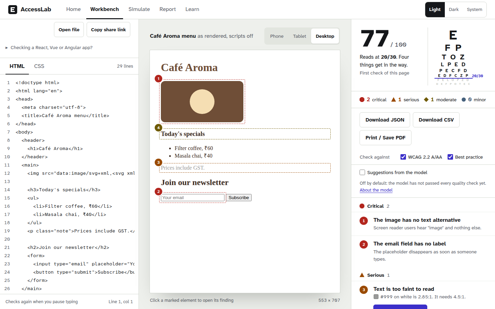      | 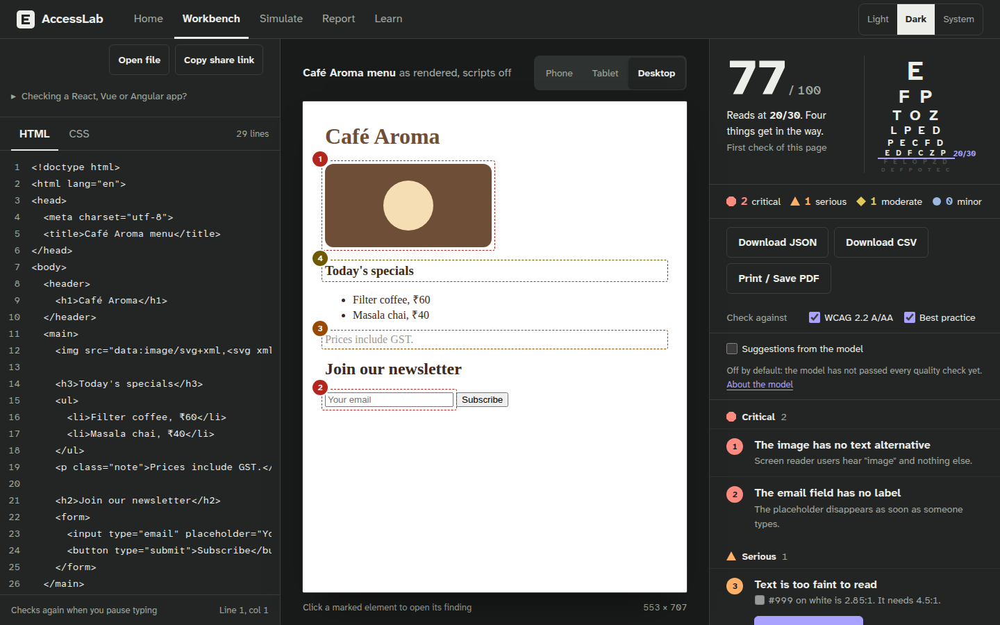      |

| An issue selected in the preview | 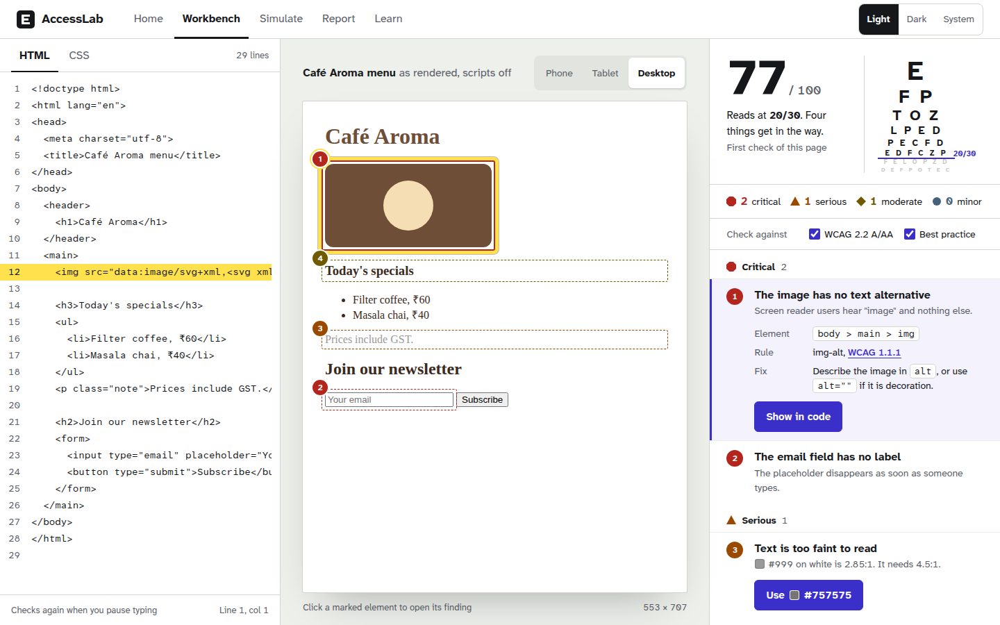     | 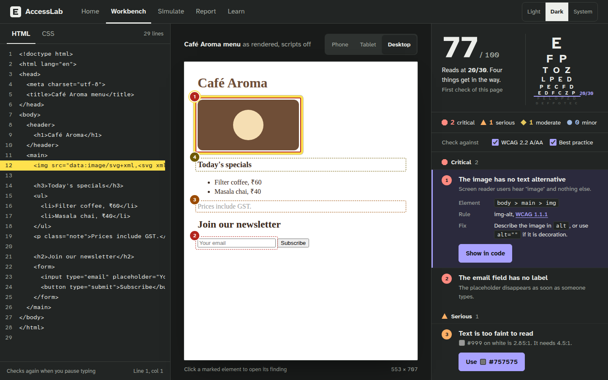     |

| No issues                        | 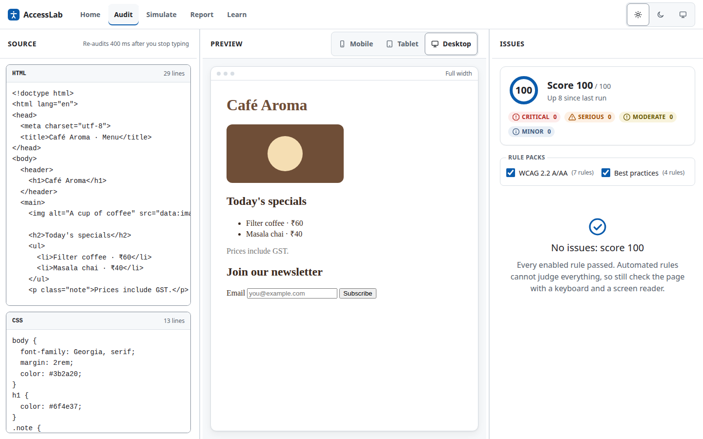             | 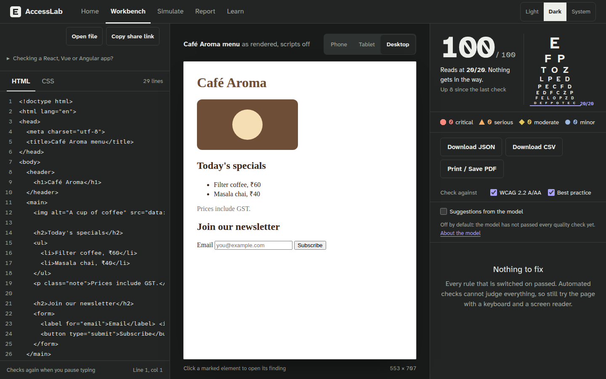             |

| Report                           | 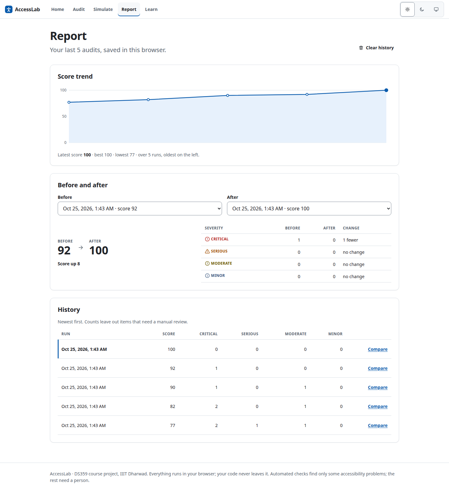                         | 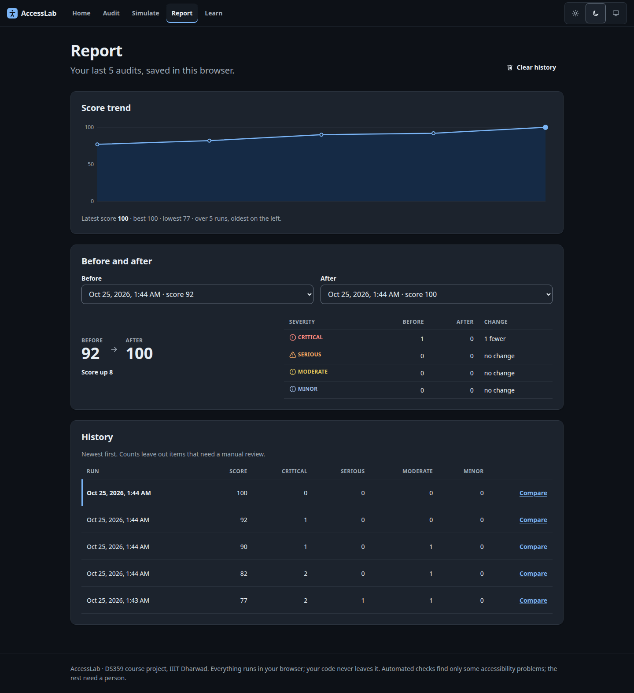                         |

| Home                             | 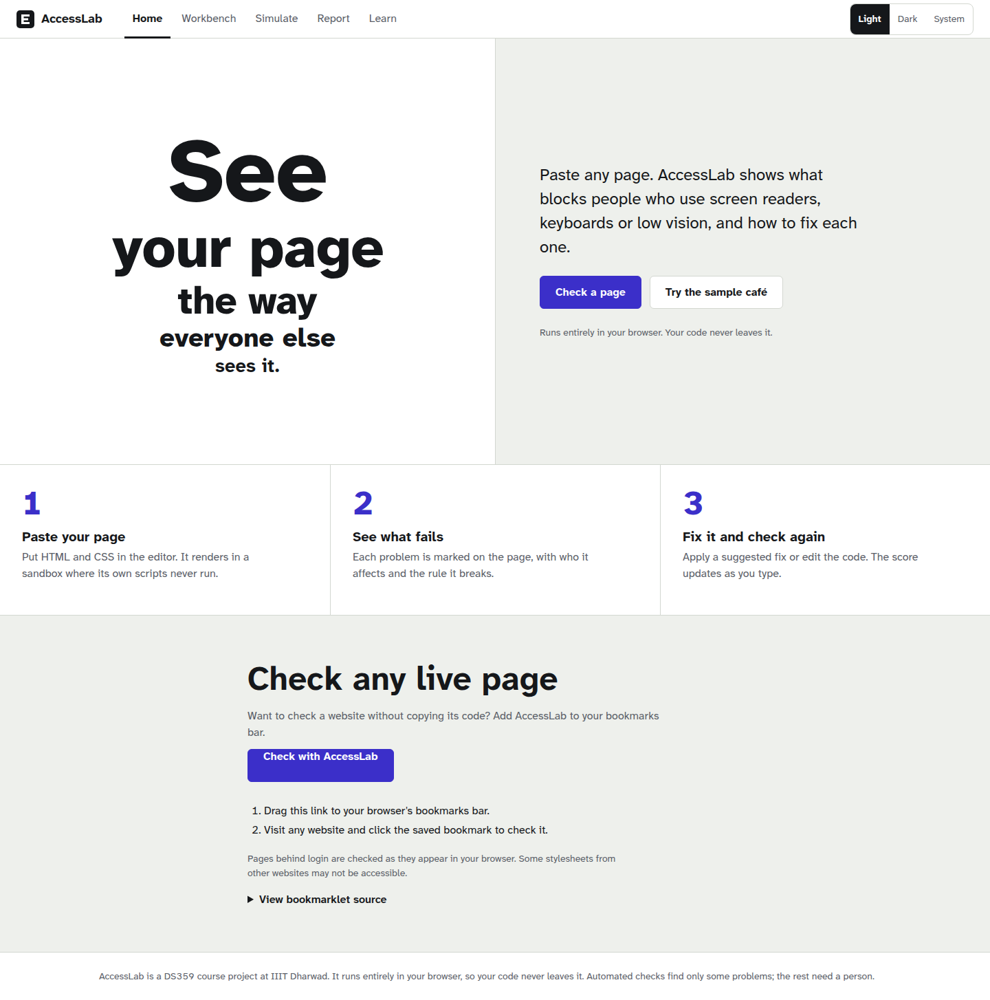                             | 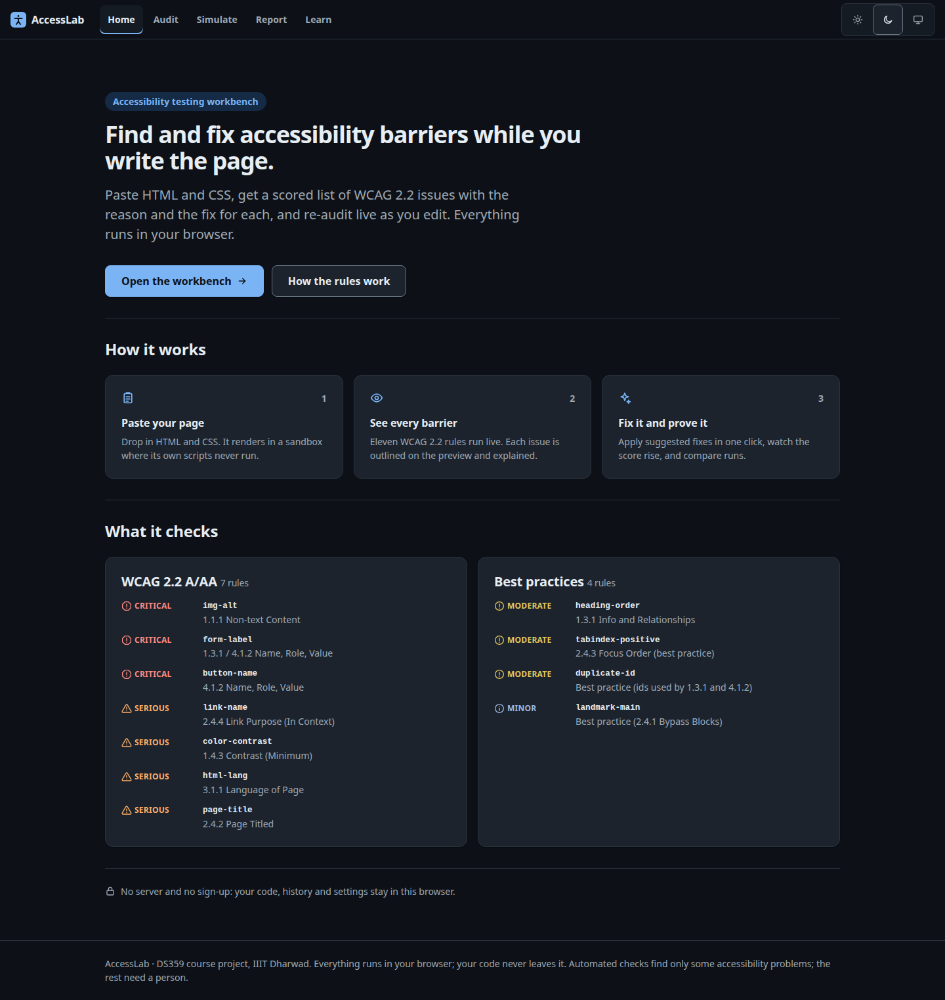                             |

| Phone                            | 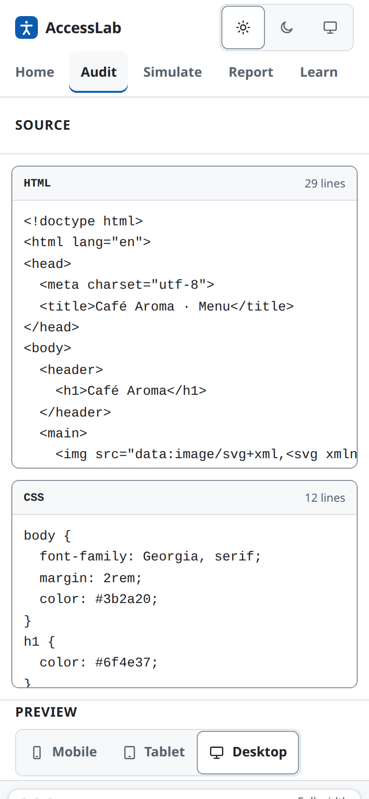 | 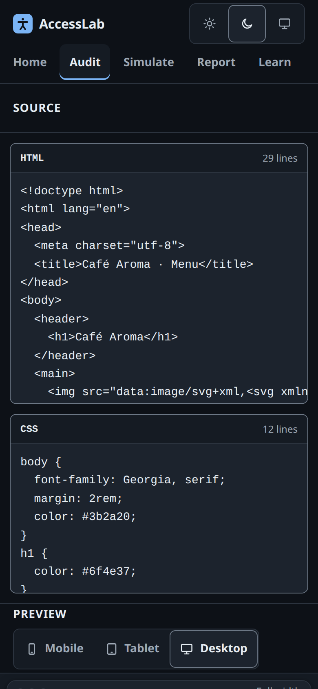 |

## Simulate

The Simulate page shows the workbench's current page in its own preview frame, a separate copy

that is never audited. Choosing a lens restyles only that copy, so a lens can never change the

audit, the score or the history. The workbench's numbered marks are drawn on the copy too, and

stay on their elements under every lens.

- **Colour vision.** Protanopia, deuteranopia and tritanopia use the matrices of Machado,

  Oliveira and Fernandes (2009) at full severity, applied as an SVG `feColorMatrix` filter.

- **Low vision.** A `blur(2px) contrast(0.8)` filter: small and low-contrast text fails first.

- **200% text size.** Doubles the root font size. Text sized in `px` does not grow, which is

  exactly what this lens reveals.

- **Keyboard tab order.** The page's focusable elements in the order Tab visits them: positive

  `tabindex` values first, then document order.

- **Screen-reader view.** What a screen reader reads in browse mode, in page order: landmarks as

  they start and end, headings with their level, links, buttons and fields as "role, name", and

  the text between them. Hidden content and decorative images (`alt=""`) are skipped, and

  anything without a name reads "(no name)".

These are teaching aids, not clinical simulations or real assistive-technology output.

## Learn

The Learn page lists a guide for each of the eleven rules, grouped by pack. Each guide

(`/learn/<rule-id>`) explains why the rule matters, how to fix it, and shows an example that

needs fixing next to an improved one.

## Keyboard shortcuts

Press <kbd>?</kbd> anywhere outside a text field for the shortcut help; <kbd>Esc</kbd> closes

it. Shortcuts are ignored while you type in a field or the editor.

| Keys                  | Action                             |

| --------------------- | ---------------------------------- |

| `Alt` + `Shift` + `H` | Go to Home                         |

| `Alt` + `Shift` + `W` | Go to the Workbench                |

| `Alt` + `Shift` + `S` | Go to Simulate (the vision lenses) |

| `Alt` + `Shift` + `R` | Go to the Report                   |

| `Alt` + `Shift` + `L` | Go to Learn                        |

| `?`                   | Open the shortcut help             |

| `Esc`                 | Close the shortcut help            |

## Model suggestions: click-only controls

Many sites build buttons from a `<div>` or `<span>` with a click handler. A mouse user never

notices, but a keyboard cannot reach them and a screen reader does not announce them (WCAG 2.1.1

and 4.1.2). The preview runs with scripts off, so those handlers never attach and the rules

cannot see the problem.

A model reads what is left in the page: 92 cues per element (tag, pointer cursor, inline `on…`

attributes, tabindex, background, rounded corners, size, text length, icons inside, and

class-name words). It reads them for the element and for its parent, children, siblings,

grandparent and grandchildren.

- **Possibly click-only.** Suggestions appear in their own group in the findings list,

  numbered and pinned on the preview, with a confidence: "Looks like a button but is not one

  (84%)".

- **Why we think so.** An open suggestion lists the cues that mattered most. These are measured

  by rescoring the element with one group of cues removed at a time.

- **Fix.** Use a `<button>`, or add `role="button"`, `tabindex="0"` and an Enter and Space

  handler. Both are shown as code you can copy.

- **Not an issue.** Hides a suggestion and keeps a record in this browser (the element's 552

  numbers, no page text). The records can be exported as JSON to retrain the model.

- **Switch.** "Suggestions from the model" sits under the rule packs. Suggestions never change

  the score, the history or the report.

- **Model card.** The model card at `/learn/model-card` shows what the model was trained on,

  how it measured on websites it never saw, where it fails and when not to trust it. Every

  number on it is read from the model's manifest.

The model runs in a Web Worker with ONNX Runtime Web. Its WebAssembly runtime is served by the

app itself (`scripts/copy-ort-wasm.mjs`, run before `dev` and `build`), and the Content Security

Policy allows `'wasm-unsafe-eval'` and `worker-src 'self'`. If the model cannot load, the switch

says "Model suggestions are unavailable" and everything else works as before.

Try it with [`docs/click-only-demo.html`](docs/click-only-demo.html). The rules score that page

100, and the model finds its four click-only controls.

**Status.** The current model is the Tranco-trained SIGN graph network and remains switched off by default.
On the site-disjoint test split (67 sites, 1,668 candidate rows), it achieved PR-AUC 0.9708,
precision 0.8925, recall 0.9486 and ECE 0.0883. The neighbourhood GBT baseline achieved
PR-AUC 0.9855, so SIGN did not outperform the baseline. SIGN also misses the precision
(`0.90`) and calibration (ECE `≤ 0.05`) ship gates. Its ONNX model is 169,515 bytes,
and the browser benchmark measured a 10 ms median for 2,664 elements; the size and latency
gates pass. Because not all ship gates pass, the model correctly remains off by default.
The Tranco-derived training corpus contains 18,345 candidate rows from 450 contributing sites
(8,751 positive and 9,594 negative labels); 879 of 1,407 crawled page records were usable.
The metrics and gate results are in [`ml/reports/evaluation.md`](ml/reports/evaluation.md).
The pipeline, dataset rebuild instructions and retraining steps are in
[`ml/README.md`](ml/README.md). Feature owner: Manasvi (branch `feature/ml-clickables`).

## Getting started

Requires Node.js 22.

```bash

npm install

npm run dev        # http://localhost:5173, then open "Workbench"

```

| Script                 | What it does                                    |

| ---------------------- | ----------------------------------------------- |
| `npm run dev` | Vite dev server with hot reload |
| `npm run build` | Production build into `dist/` |
| `npm run preview` | Serve the production build locally |
| `npm run lint` | ESLint, including `eslint-plugin-jsx-a11y` |
| `npm run format` | Format every file with Prettier |
| `npm run format:check` | Check formatting without changing files (CI) |
| `npm test` | Vitest in watch mode (`npm test -- --run` once) |
| `npm run coverage` | Tests with a coverage report |
| `npm run ml:bench` | Time the model in the built app's Web Worker |
| `npm run bench:typing` | Typing benchmark in headless Chrome |

## Architecture

```

src/

  engine/      plain JavaScript, no React: rules, registry, scheduler, contrast, DOM helpers

               (accessible names, roles, focus order, linearizer), simulation filters,

               ml/ (features shared with the crawler, model worker, explanations)

  features/    one folder per feature: editor, audit (workbench), simulate, learn, report, ...

  app/         store, router, layout

  components/  shared UI (header, footer, segmented control, severity shapes)

  context/     SettingsContext: theme, motion, enabled rule packs

  services/    guarded localStorage access

tests/         Vitest + jsdom: engine fixtures, reducers, components, model

ml/            offline model pipeline: crawler, labels, training, reports (see ml/README.md)

public/models/ the shipped model and its manifest

```

- **The engine never imports React or Redux**, so it is tested on its own with jsdom and could

  run in a browser extension or CI tool unchanged.

- **Issues are plain data.** Each issue refers to its element by a unique CSS selector, never by

  a DOM node, so audit results live in Redux and survive re-audits.

- **Audits run in time slices.** Rules need the live DOM, so they run on the main thread, but

  the scheduler yields to the browser every ~12 ms and a newer edit aborts a stale audit.

- **One audited document.** Only the workbench's preview is audited. Simulate renders its own

  copy, so nothing a lens does can reach the audit.

- **No backend.** History and preferences are kept in `localStorage`.

## Rule catalogue

| Rule                | Checks                                                  | WCAG 2.2                 | Severity | Pack          |

| ------------------- | ------------------------------------------------------- | ------------------------ | -------- | ------------- |

| `img-alt`           | `` without an `alt` attribute                      | 1.1.1 Non-text Content   | Critical | WCAG 2.2 A/AA |

| `form-label`        | Field with no label, or named only by placeholder/title | 1.3.1, 4.1.2             | Critical | WCAG 2.2 A/AA |

| `button-name`       | Button with no accessible name                          | 4.1.2 Name, Role, Value  | Critical | WCAG 2.2 A/AA |

| `link-name`         | Link with no accessible name (e.g. an icon-only link)   | 2.4.4 Link Purpose       | Serious  | WCAG 2.2 A/AA |

| `color-contrast`    | Text below 4.5:1, or below 3:1 for large text           | 1.4.3 Contrast (Minimum) | Serious  | WCAG 2.2 A/AA |

| `html-lang`         | `<html>` without `lang` (full pages only)               | 3.1.1 Language of Page   | Serious  | WCAG 2.2 A/AA |

| `page-title`        | Missing or empty `<title>` (full pages only)            | 2.4.2 Page Titled        | Serious  | WCAG 2.2 A/AA |

| `heading-order`     | Heading level skipped, e.g. h1 → h3                     | 1.3.1 (best practice)    | Moderate | Best practice |

| `tabindex-positive` | `tabindex` greater than 0                               | 2.4.3 (best practice)    | Moderate | Best practice |

| `duplicate-id`      | Repeated `id` values                                    | Best practice            | Moderate | Best practice |

| `landmark-main`     | No single `<main>` landmark (full pages only)           | Best practice (2.4.1)    | Minor    | Best practice |

**Scoring.** Each rule owns a share of the score in proportion to its severity weight

(critical 10, serious 6, moderate 3, minor 1). A rule with _n_ issues loses 1 − 0.5ⁿ of its

share, so the first issue costs half and one noisy rule can never drive the score to zero.

Text on images or gradients is listed for manual review and is not scored.

## Testing

`npm test -- --run` runs the whole suite: unit tests for the contrast maths, a passing and a

failing fixture for every rule, registry validation, scheduler slicing and cancellation, focus

order, the screen-reader linearizer, the simulation filters, reducers, and React Testing

Library tests for the workbench, the issue list, settings, shortcuts and the rule that a lens

never changes the audit. The model has tests for:

- the 92 features and the neighbourhood views;

- parity between the app and the crawler's copy of the feature code;

- the explanations;

- the model runner with the real model, including a version mismatch and a missing file;

- ONNX Runtime Web against the training code on 50 stored rows;

- the interface: suggestions never change the score, "Not an issue" persists, and fallback

  when the model is unavailable.

The pipeline has its own tests in `ml/` (`npm test` for the labeller and the Chromium/jsdom

feature parity, `python -m pytest train/tests`). CI (GitHub Actions) runs lint, a Prettier format check, the tests and the

production build on every pull request.

## Limitations

- Automated checks find only part of the real accessibility problems; meaningful alt text,

  sensible reading order and caption quality still need a person.

- The accessible-name computation is a documented subset of the W3C algorithm.

- Contrast ignores `opacity` and text shadows, and flags text over images or gradients for

  review rather than guessing.

- The simulations, tab order and screen-reader view are approximations for learning, not a

  replacement for testing with disabled people and real assistive technology.

- Scripts in the audited page never run, so pages that build their content with JavaScript are

  audited in their initial state.

- Live websites cannot be audited by URL: browsers block reading other sites (CORS).

- Model suggestions use a Tranco-derived corpus from 450 contributing sites.
    Labels have known noise, including delegated click handlers that the static label probe may
    not attribute to individual elements. An automated 300-label audit judged 188 examples and
    marked 112 unsure; it found no wrong labels among the judged examples, but only four judged
    examples were positive. This is not an independent manual owner review. The current test
    errors (151 false positives and 68 false negatives) still need manual review. The model ships
    switched off because it misses three of the five ship gates; see `ml/reports/evaluation.md`.

## Status

Milestones 1 (scaffold, first audit) and 2 (rule packs, contrast and fixes, all eleven core
rules, overlays, sliced audits, report) are complete. Milestone 3 work so far: the Simulate page
(colour-vision, low-vision and 200% text lenses, the tab-order list and the screen-reader view),
the Learn guides, keyboard shortcuts, share links and file import. Still to come: CodeMirror
editors.
